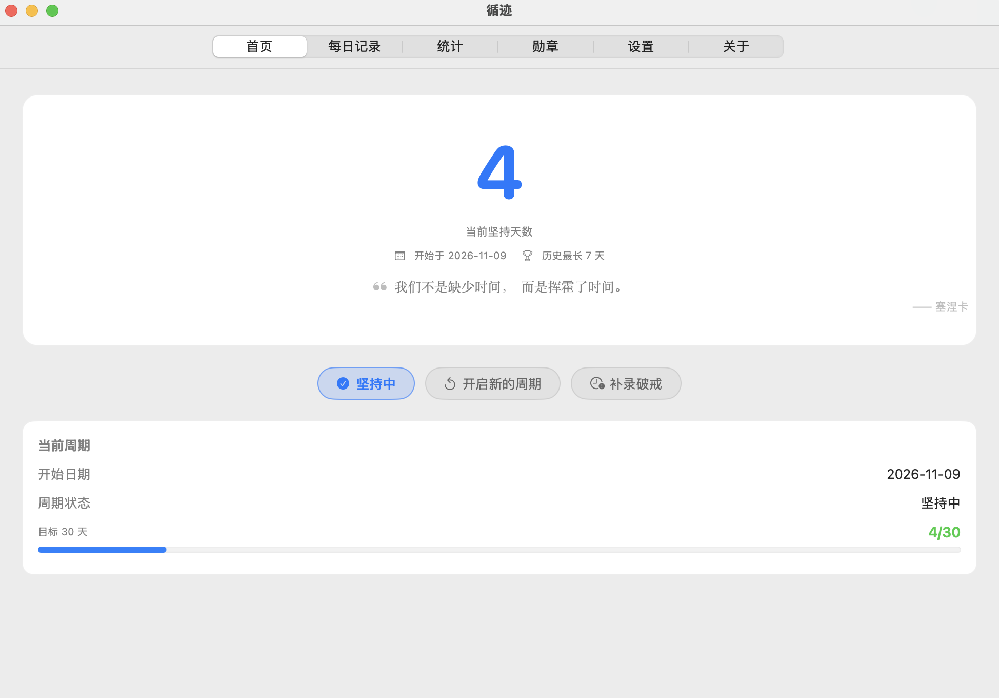
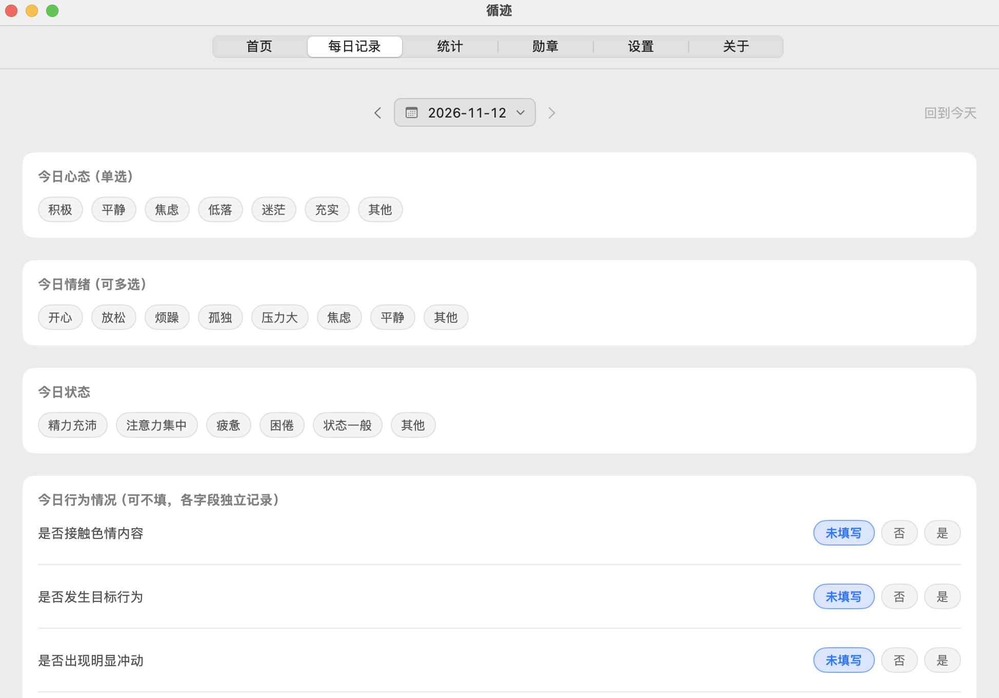
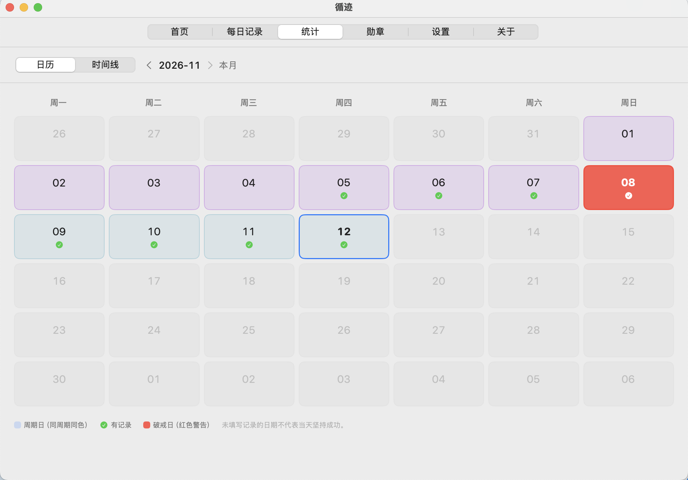
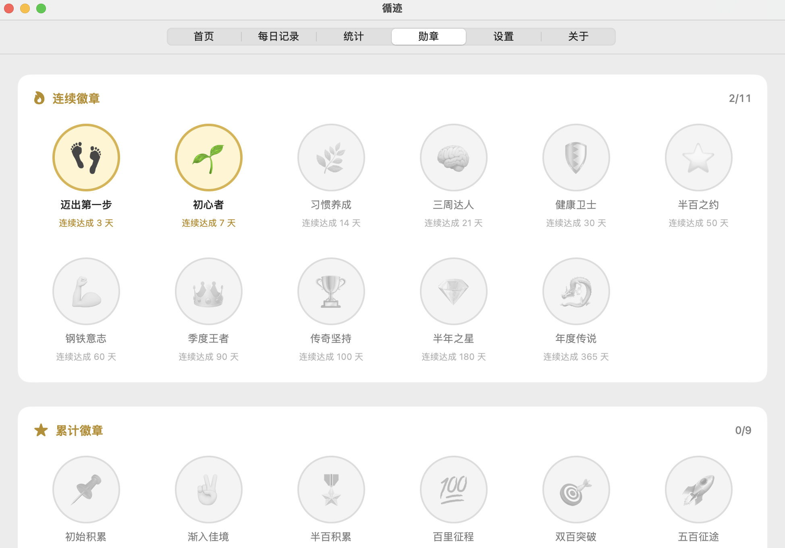
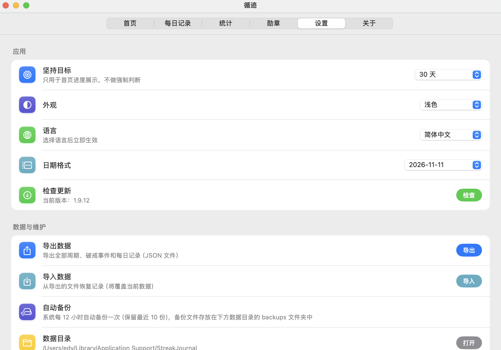

# 循迹 · StreakJournal

**一款纯原生 SwiftUI 打造的 macOS 坚持记录应用** —— 记录你的每日坚持、管理周期、标记破戒、点亮勋章。

[](https://github.com/GYY-y/streakjournal/releases/latest)
[](https://github.com/GYY-y/streakjournal/actions/workflows/release.yml)


> 仅支持 **Apple Silicon (M 系列) Mac**，macOS 14.0+。不上架 App Store，通过 GitHub Releases 分发。

---

## 界面预览

| 首页 | 每日记录 |
| :---: | :---: |
|  |  |

| 统计（日历 + 时间线） | 勋章墙 |
| :---: | :---: |
|  |  |

| 设置 |
| :---: |
|  |

---

## 功能特性

### 每日记录
- **自动保存**：写完即存，无需手动点击保存按钮
- **结构化模板**：今日心态（单选）、情绪（多选）、状态、行为情况三问（是/否/未填写）
- **自由记录**：不受模板限制的文字备注，想写什么写什么
- **破戒日独立**：破戒当天独立保存、不计入任何周期的坚持天数，支持补录

### 周期管理
- 开启新的周期只结束当前周期，**历史记录完整保留**
- 跨月周期在日历中以真日历（含相邻月份补齐）展示，同周期同色
- 时间线按月浏览，破戒日以红色警示

### 勋章系统
- **11 枚连续徽章**（连续 3/7/14/21/30/50/60/90/100/180/365 天）+ **9 枚累计徽章**（累计打卡 10~500 次）
- 新解锁时全屏撒花庆祝；点击已获得的勋章弹出深色展示卡，撒花聚焦勋章迸发

### 统计视图
- 日历视图 + 时间线视图，按月切换
- 按周期、破戒日、有记录筛选

### 菜单栏速览
- 顶部菜单栏常驻图标，点击弹出**系统原生菜单**（零动画、原生悬停高亮）：
  - 已坚持天数 / 今日记录状态（未记录红色提醒）
  - 打开主窗口 / 设置（⌘,）/ 退出（⌘Q）

### 数据与隐私
- **100% 本地存储**：全部数据只保存在本机 SQLite 数据库，无联网上报
- **每 12 小时自动备份**一次（保留最近 10 份），无需任何手动操作
- 支持导出 / 导入 JSON，方便迁移或异地存档
- 一键重置全部数据（二次确认，自动备份仍保留）

### 检查更新
- 应用内一键检查 GitHub 最新 Release，有新版本时引导前往下载页

### 多语言
- 简体中文（默认）/ 繁體中文 / English，切换立即生效

### 其他
- 浅色 / 深色 / 跟随系统外观
- 每天一条哲学语录系统通知（本地通知，无需网络）

---

## 下载安装

1. 前往 [**Releases 页面**](https://github.com/GYY-y/streakjournal/releases/latest)
2. 下载最新版 `StreakJournal-vX.X.X-arm64.dmg`
3. 打开 DMG，将 **循迹** 拖入 Applications 文件夹
4. 首次打开若提示"无法验证开发者"，解决方法：
   - 右键 / 按住 **Control** 单击 App → 选择「打开」
   - 或到 **系统设置 → 隐私与安全性 → 仍要打开**

> 应用未做开发者签名（开源免费，无公证费用），首次打开需要上述确认，之后正常。

---

## 数据存放位置

```
~/Library/Application Support/StreakJournal/
├── streakjournal.db      # SQLite 数据库（全部数据）
└── backups/              # 自动备份（每 12 小时一次，保留最近 10 份）
```

- 升级应用、重启电脑不会影响数据
- 备份与本机数据库在同一块硬盘：建议同时开启 macOS 时间机器做异地保险
- 应用内可随时导出 JSON 存到网盘 / U 盘

---

## 从源码构建

```bash
git clone https://github.com/GYY-y/streakjournal.git
cd streakjournal
bash scripts/build_app.sh     # 编译并组装 StreakJournal.app（产物在 build/）
bash scripts/make_dmg.sh      # 打包 DMG 安装镜像
```

**技术栈**：Swift + SwiftUI，零第三方依赖；系统 SQLite3 持久化、UNUserNotificationCenter
本地通知、NSStatusItem 原生菜单。
CI 使用 GitHub Actions（macos-15 runner）自动构建并发布 Release。

---

## 项目结构

```
Sources/StreakJournal/
├── App/          # 应用入口、菜单栏状态项、每日通知
├── Core/         # 数据库、Store、日期工具、国际化词典、勋章定义、语录库、更新检查
└── Views/        # 首页 / 每日记录 / 统计 / 勋章墙 / 设置 / 关于 / 详情弹层 / 周期面板
scripts/          # 构建与打包脚本
tools/            # 图标生成器
docs/screenshots/ # 界面截图
.github/          # Release 工作流
```
